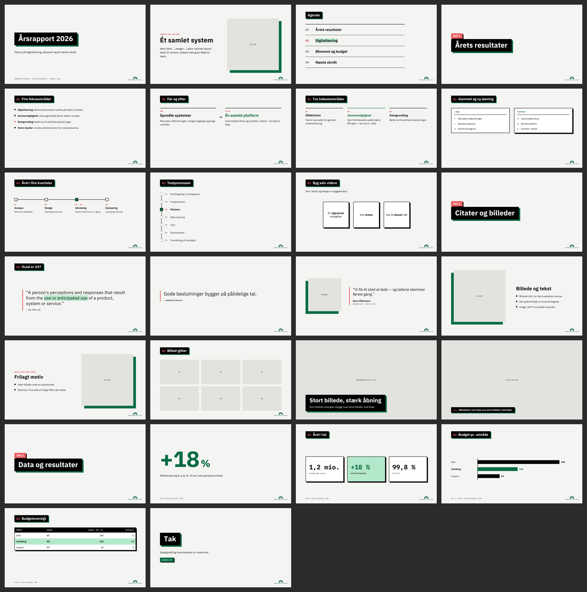

# Økonomistyrelsens slide-system

Slide-system til **PowerPoint** og **HTML-slides**: lys grå grund, titler i sorte blokke med
grøn skygge, laks-labels, billeder med en grøn flade forskudt bagved, IBM Plex Sans + Mono.
**Én stil**, 22 slide-typer, og byggeklodser til egne diagrammer.



## Galleri

- **HTML:** [`template.html`](template.html) — pil/mellemrum/klik navigerer, Ctrl/Cmd+P printer til PDF.
- **PowerPoint:** [`example.pptx`](example.pptx) — bygget af `deck.example.py`.

## Brug

```bash
pip install python-pptx pillow fonttools lxml
python deck.example.py        # -> example.pptx + preview/slide-NN.png
```

```python
from build_pptx import Deck

deck = Deck()
deck.title("Årsrapport 2026", lead="Status og næste skridt.", meta="Økonomistyrelsen · August 2026")
deck.section("Årets resultater", num="01")
deck.content("Fire fokusområder", [("Digitalisering: ", "økonomiprocesser samles."), "…"])
deck.stats([{"num": "+18 %", "label": "Effektivisering", "trend": "up"}], title="Året i tal",
           source="Kilde: Statens Regnskab, 2026")
deck.save("mit-deck.pptx", preview_dir="preview-mit-deck")
```

`preview_dir` giver et PNG pr. slide, tegnet med de rigtige IBM Plex-metrikker — så layoutet
kan tjekkes uden PowerPoint. `save()` advarer, hvis tekst ikke kan være i sin boks.

## Indhold

| Fil | Hvad |
|---|---|
| `build_pptx.py` | **Stilen:** tokens, byggeklodser (`card`, `block`, `chip`, `square_list`, `picture`) og `Deck` med alle slide-typer |
| `oes_pptx.py` | **Motoren:** elementer, tekst-ombrydning, .pptx-skrivning, PNG-preview, font-indlejring |
| `deck.example.py` | Galleriet i PPTX-form → `example.pptx` |
| `template.html` | Galleriet i HTML-form |
| `slides.css` / `slides.js` | Al HTML-styling + navigation. Samme mål og farver som `build_pptx.py` |
| `PRESENTATIONS.md` | Den fulde guide: DNA, farver, typeskala, faste mål, slide-typer |
| `CLAUDE.md` | Entry point for Claude Code |
| `verify.py` | Regressionstjek af hele systemet |
| `tjek_pptx.py` | Lag- og kontrasttjek af en vilkårlig .pptx |
| `assets/` | ØS-logoer + IBM Plex Sans/Mono (`fonts/`, med OFL-licens) |
| `slides-oes.css` | Udfaset shim der importerer `slides.css` |

## De faste mål

Alt måles i px på et 1280 × 720-canvas — de samme tal i PPTX og HTML.

| | px | `build_pptx.py` | `slides.css` |
|---|---|---|---|
| Sidemargin | 88 | `PAD_X` | `--pad-x` |
| Titelblok, top | 64 | `TITLE_Y` | `--title-y` |
| Indhold | 176 → 640 | `CONTENT_TOP` / `CONTENT_BOT` | `--content-top` / `--pad-bottom` |
| Billedramme | 470 @ 125 | `MEDIA` / `MEDIA_Y` | `--media` |
| Grøn flade bag billeder | 24 | `OFFSET` | `--offset` |
| Kant / hård skygge | 3 / 8 | `BORDER` / `SHADOW` | `--border` / `--shadow` |
| Logo, hjørne-luft | 32 | `LOGO_INSET` | `.slide::after` |
| Kilde-linje, underkant | 682 | `SOURCE_BOTTOM` | `.slide__source` |

## Tjek at intet er skredet

```bash
python verify.py                # hele systemet
python verify.py mit-deck.pptx  # ét deck: geometri, fonte, lag og kontrast
```

Bygger galleriet og kontrollerer referencemålene, geometrien i den genererede fil,
font-indlejringen, at `slides.css` og `build_pptx.py` har samme mål og farver, at begge
gallerier viser hver slide-type, at ingen tekst er dækket eller under WCAG AA-kontrast, og
at ingen tekst flyder ud af sin boks. Exit-kode 1 ved fejl.

## Fonte følger med filen

IBM Plex **indlejres i hver genereret .pptx** (som EOT), så typografien holder på en låst
VDI, hos modtagere og på mødelokale-PC'en. `slides.css` bruger de samme filer via
`@font-face`, så HTML-slides virker offline. Fontfilerne ligger i `assets/fonts/`
(fra [github.com/IBM/plex](https://github.com/IBM/plex), v6.4.0, OFL — `LICENSE.txt` skal
følge med). Slå indlejring fra med `Deck(embed_fonts=False)`.

## Ældre decks

Gamle deck-scripts kører uændret: `Deck`-metoderne har samme navne og argumenter som før
(`title`, `section`, `content`, `split`, `stats`, `table`, …) — de tegner blot i den nye stil.
Ældre HTML-decks der linker `slides.css` får også den nye stil; `image-text`-slides bør
flytte overskriften ind i `.text-col` som `<h2 class="slide-h2">` (se `template.html`).
